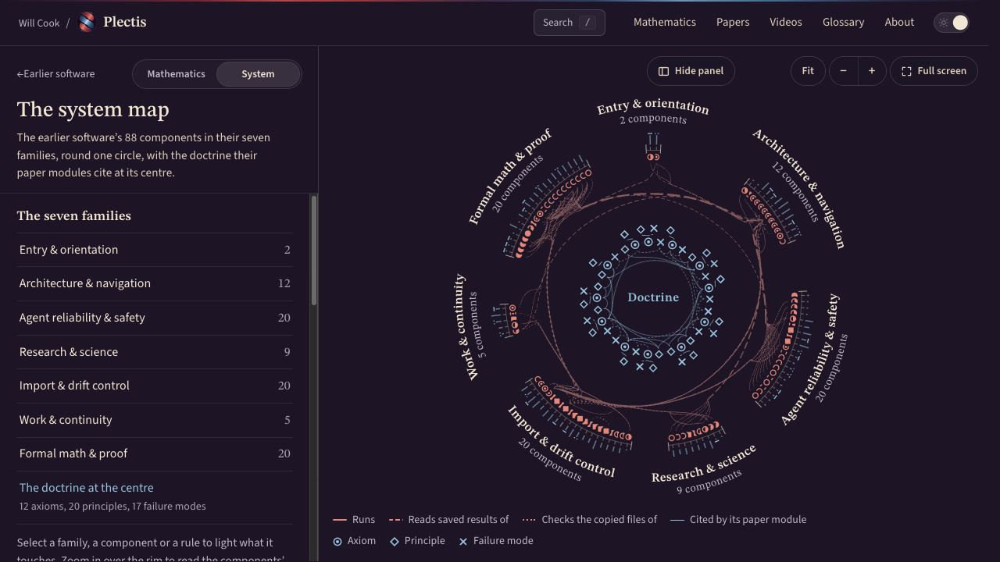

# Plectis

**Check what a change preserves and what it invalidates.**

Plectis is a public Python toolkit for experiments in AI-assisted research.
Its workflow operations use formally verified decision cores to plan reruns,
check interface replacements and derive public-only reports. This research
prototype also includes reference components for proof checking, agent
reliability, forecasting and keeping documents consistent with their sources.
A fourth verified core checks whether their replay evidence satisfies the
declared source, input, claim-policy and receipt contract. Twelve component
computations also have [their own specifications and proofs](formal/components/README.md).

[Run the workflow example](#formally-checked-workflow-operations) ·
[Check component replays](#checking-a-component-result) ·
[Inspect the proofs](formal/README.md) ·
[Build a frontend](docs/guides/frontend-implementation.md) ·
[Browse the reference toolkit](#try-the-repository-tour) ·
[Documentation](docs/README.md) · [Source map](#repository-layout)

### Formally checked workflow operations

The current experiment asks a simple question: **“I changed this workflow.
Which results can I keep, and what must run again?”** With Python 3.11+, try:

```bash
git clone --depth 1 https://github.com/wcook04/plectis && cd plectis
PYTHONPATH=src python3 examples/operations/evaluation.py --format text
```

The example changes a scoring rule: eight results are reused, three tasks rerun,
and one external action stays blocked. An old worker cannot publish over the new
result. Everything runs locally in a temporary directory, without model calls.
[Read the walkthrough](docs/guides/verification-study.md), then import the
operations you need:

| Operation | Question it answers | Proof or implementation |
|---|---|---|
| [`plectis.repair`](docs/guides/repair.md) | What can I reuse after a declared change? | [Verified graph planner](formal/repair/Repair.dfy) → [generated Python](src/plectis/repair/_generated/Repair.py). |
| [`plectis.compatibility`](docs/guides/compatibility.md) | Does this replacement preserve the caller's allowed actions and outputs? | [Transition-model proof](formal/compatibility/Compatibility.dfy) → [generated Python](src/plectis/compatibility/_generated/Compatibility.py). |
| [`plectis.views`](docs/guides/public-views.md) | Can this mixed report become a public-only job with the same public output? | [Report-language proof](formal/views/Release.dfy) → [generated Python](src/plectis/views/_generated/Release.py). |
| [`plectis.publish`](docs/guides/publish.md) | Can this worker still publish this result? | [Tested SQLite host](src/plectis/publish.py); no formal implementation proof. |

The generated Python is the code these APIs call. The proofs cover the supplied
graph, transition models and report language; Python adapters, SQLite and
external services remain outside them. These are independently importable
research prototypes. An ordinary cache makes the same reuse decisions in this
example; practical benefits over that baseline still need evaluation.

To recheck the proofs with **Dafny 4.11.0**:

```bash
make verify-operations DAFNY=/path/to/dafny
```

This verifies the three workflow cores and replay admission, regenerates Python
byte for byte and requires
deliberately broken variants to fail. `make check` checks the saved hashes
without running the prover. Read the [assumptions and trusted tools](formal/README.md)
or [copy and install an operation](examples/operations/README.md).

### Try the repository tour

For the broader reference toolkit, run this after cloning the repository as
shown above:

```bash
PYTHONPATH=src python3 -m plectis tour --format text .
```

The tour lists project files and suggests a task. It does not run your tests or
change your source.

## Can I use it today?

Yes, for the four operation APIs above, the documented local commands and
selected examples. Start with the [workflow study](docs/guides/verification-study.md)
or the [quickstart](QUICKSTART.md), then
check the chosen component's inputs, dependencies and stated limits before
adapting it to your own project.

| Status | What that means here |
|---|---|
| **Usable today** | Four portable operation APIs, project inventory and selected examples; follow each operation's prerequisites. |
| **Tested** | Named inputs and failure cases; the completion example includes Git and pytest subprocesses. |
| **Experimental or unverified** | New project adaptations and end-to-end research automation need separate validation. |

The 88-component catalogue lists individual replays, not an integrated public
research platform; check each replay's requirements. The [overview](docs/overview.md#the-public-workflow)
shows one command's input, output and limits. The larger private workbench is
separate from this clone.

## Checking a component result

A component runs its checker on supplied inputs and saves a receipt. The shared
replay host captures source and input identities, the declared claim policy,
the returned result, the public payload sent to the receipt writer, and the saved
receipt. A [Dafny-verified admission rule](formal/replay/README.md)
then requires exactly one matching result for every selected component, with no
missing or duplicate rows, changed identities, altered public payloads or missing
required execution evidence. Replay commands call its generated Python.

```bash
make component-replays
```

This runs the current catalogue and writes new results under
`.microcosm/component-replays/`; it needs the components' native tools, including
Lean/Lake and Swift. The [replay guide](docs/maintainers/validation.md#fresh-component-replays)
lists prerequisites and the [study](docs/guides/verification-study.md#checking-the-component-replay-itself)
shows the failure cases behind the design.

To replay one exact component ID with its declared inputs, run:

```bash
plectis component-replay pattern_binding_contract --root .
```

The result covers that selected component only. It writes a fresh run below
`.microcosm/` and reports missing inputs or tools without passing them.
Receipts mark runtime source identity as `package_roots_v1`: byte and mode
hashes for `microcosm_core` and `plectis`, including generated kernels.
Standard-library and third-party dependency behavior remains trusted; the
receipt separately binds project source, routes, registry, core policy,
standards and inputs. The
[shared replay host and isolated backend API](docs/maintainers/architecture.md#single-component-replay)
keep receipt observation and admission in the existing execution path.

The [component proof index](formal/components/README.md) identifies twelve
computations with their own verified specifications and generated implementations.
Their adapters supply normalized observations; the component writes a result and
receipt, and the separate admission core checks the captured replay evidence.
Hashing, file capture, host normalization and the producer's choice of public
receipt fields remain tested Python boundaries. A replay cannot inherit a proof
of component correctness from another core or from the number of components that
passed.

## Why this exists

AI-assisted research can span many sessions, files and failed approaches.
Plectis explores how to preserve that work so another person can understand
what was tried, check the results and choose a useful next step. Experts can
contribute a correction or direction without operating the AI themselves.

This toolkit publishes selected parts of that effort. The
[mathematics repository](https://github.com/wcook04/plectis-erdos) contains the
papers, proofs and open questions; the [website](https://wcook04.github.io/plectis/)
explains both. The [project overview](docs/overview.md) relates these parts to
other research tools.

<a id="choose-a-route"></a>

## Choose a starting point

| You want to… | Start here |
|---|---|
| Change a workflow with declared guarantees | [Run the verification study](docs/guides/verification-study.md) and [choose an operation](examples/operations/README.md) |
| Understand the project | [Why these tools belong together](docs/overview.md) |
| Run something locally | [Quickstart](QUICKSTART.md) |
| Follow a complete example | [Worked guides](docs/guides/README.md) |
| Find a tool in your field | [Component map](ORGANS.md) |
| Work on the code | [Contributing](CONTRIBUTING.md) and [implementation map](docs/maintainers/architecture.md#implementation-map) |
| Read the mathematics | [Companion reader's guide](https://github.com/wcook04/plectis-erdos/blob/main/docs/READING_GUIDE.md) |

## See it work

A separate [report-compilation experiment](docs/guides/public-views.md) changes
one mixed recipe, derives a public-only program and checks that a private
condition cannot control whether a public line appears. An ordinary public-only
renderer produces the same output; the value of maintaining one checked recipe
still needs evaluation. Run it with:

```bash
PYTHONPATH=src python3 examples/operations/public_views_recipe_change.py
```

An AI says: “I committed the fix and the tests passed.” The
[completion-checking guide](docs/guides/checking-agent-completion.md) shows how
one component checks those claims using a sample Git repository and actual
pytest runs. It verifies three supplied claims and rejects four deliberately
incorrect ones. You can follow the result back to the code that checked it.

Two more [worked guides](docs/guides/README.md) show different uses:

- [Change a prompt-injection example](docs/guides/prompt-injection.md)
  and see a checker reject an inconsistent permission in saved records.
- [Prepare a research question](docs/guides/hypothesis-handoffs.md) with a
  tentative answer, alternatives and proposed observations for an expert.

Try the second example from the clone, without installing anything:

```bash
PYTHONPATH=src python3 -m plectis hypothesis-handoff \
  --input examples/hypothesis_handoff/independent_evaluation.json --format text
```

It validates the supplied file and prints the question and proposed
investigation. It does not answer the question, contact an expert or call a
model. Each guide explains what its example tests and what remains untested.

## What is in the toolkit?

There are **88 components**, grouped into seven areas. A component is a named
program or group of related programs, with its own instructions and stated
limits. Some run a computation or an external tool; others compare supplied
records against rules. An entry in the catalogue is not a promise that every
example can run in every environment: its page lists required tools and source
files, and the runner reports unavailable requirements.

| Area | Try it for… |
|---|---|
| [Entry and orientation](ORGANS.md#entry--reveal) | Checking that a suggested first step names an available command and result file. |
| [Architecture and navigation](ORGANS.md#architecture--navigation) | Comparing a selection of files and components with an expected selection. |
| [Mathematics and proof](ORGANS.md#formal-math--proof) | Trying proof steps on supplied theorems and asking Lean to check them. |
| [Agent reliability and safety](ORGANS.md#agent-reliability--safety-replays) | Testing records of prompt injection, poisoned memory or completion claims. |
| [Research and forecasting](ORGANS.md#research--science-replays) | Comparing forecast errors on synthetic data. |
| [Source and generated files](ORGANS.md#import-projection--drift) | Comparing file fingerprints and checking that declared outputs exist. |
| [Work and continuity](ORGANS.md#work-landing--continuity) | Checking that a work record names its changes, validation results and commits. |

<a href="https://wcook04.github.io/plectis/docs/system-map.html">
  
</a>

[**Explore the system map →**](https://wcook04.github.io/plectis/docs/system-map.html)
<br>
<sub>Select a component or rule on the website to follow its connections.</sub>

Browse the live [component pages](https://wcook04.github.io/plectis/docs/components.html),
[papers](https://wcook04.github.io/plectis/#papers) and
[films](https://wcook04.github.io/plectis/#videos) on the
[Plectis website](https://wcook04.github.io/plectis/). For text indexes and
source links, use the [agent navigation guide](https://wcook04.github.io/plectis/llms.txt).
For mathematical papers, Lean proofs and open questions, follow the
[Plectis Erdős reader's guide](https://github.com/wcook04/plectis-erdos/blob/main/docs/READING_GUIDE.md)
or the [mathematics map](https://wcook04.github.io/plectis/maths/universe.html).

To search component descriptions from the terminal:

```bash
PYTHONPATH=src python3 -m plectis comprehend --slice mechanism --format text
PYTHONPATH=src python3 -m plectis comprehend --first-action "prompt injection" --format text
```

The search uses phrase and word matching to suggest a command and relevant files.
It neither calls an AI model nor executes the suggested command.

## How it works

Most components run independently. They share command handling, file formats
and a catalogue that names each component's code, inputs, checks and saved
results. The catalogue also supplies the generated documentation and maps.
The connections between components are recorded where they exist; the seven
areas are a browsing aid, not seven stages that every run executes.

To understand a component, open its example input, the source function that
processes it and the output it produces. Compare that output with the test or
expected result. Then change an input in a disposable copy and check whether
the result changes as expected. The [worked guide](docs/guides/prompt-injection.md)
follows this path through one component.

The project tour is a separate orientation command. It mostly classifies
filenames and paths, with limited inspection of Python entry points. It
writes a file inventory, suggested tasks and a simulated task record under
`.microcosm/`, an ignored directory retained from the project's former name.
A saved run result is called a *receipt* in the source. It records what ran and
which inputs and results it refers to; it does not by itself prove a claim.
To see the tour's structured output:

```bash
PYTHONPATH=src python3 -m plectis tour --card .
```

[Architecture](ARCHITECTURE.md) maps the implementation. The
[maintainer guides](docs/maintainers/README.md) explain command dispatch,
data ownership and how to regenerate the maps.

## Explore with a coding agent

A coding agent is an AI assistant that can read files, run commands and edit
code. You can use your own to explore this repository. Open a current clone
and ask, for example:

> Read AGENTS.override.md. I want to understand how this project checks an
> agent's claim that a task is finished. Find the relevant example, explain
> its inputs, run it, and show me the result and the code that checks it.
> Explain what this run establishes and what it leaves untested. Include the
> checkout commit and commands so I can repeat it.

The [agent quickstart](QUICKSTART.md#use-your-own-coding-agent) explains where
to save results. [AGENTS.md](AGENTS.md) contains the editing instructions.
The toolkit's local examples do not require a model API key; your chosen
coding agent has its own account and provider requirements.

## Install

The basic commands run from a clone with **Python 3.11 or newer**, without
third-party runtime dependencies. The shell examples above work on macOS,
Linux and WSL. In Windows PowerShell, first set `$env:PYTHONPATH = 'src'`,
then use `python -m plectis` in place of `PYTHONPATH=src python3 -m plectis`.
Individual examples may require Git, pytest, Lean or other tools; follow the
selected example's instructions.

To install the shorter `plectis` command on macOS or Linux:

```bash
python3 -m venv .venv
.venv/bin/python -m pip install .
.venv/bin/plectis tour --format text .
```

Use the virtual environment if your system Python reports
[`externally-managed-environment`](https://peps.python.org/pep-0668/).
For development dependencies, Windows
installation commands and other options, see [Quickstart](QUICKSTART.md),
[Contributing](CONTRIBUTING.md) and [troubleshooting](docs/README.md#troubleshooting).
The older `microcosm` command remains an alias.

## Build a frontend against the component backend

The local API lets a client search components, read their claims and guides,
inspect modeled proofs and saved results, and follow typed relationships.
Start it from this clone with Python 3.11 or newer:

```sh
PYTHONPATH=src python3 -m plectis serve-components
curl 'http://127.0.0.1:8766/api/v1/components?q=ownership&limit=10'
```

The first command stays running; issue the request in another terminal.
The response includes matching components and the revision of the index they
came from. `/api/v1/openapi.json` supplies the machine-readable contract.
There are no third-party runtime dependencies for this server.

Give a frontend developer or Claude the
[frontend implementation brief](docs/guides/frontend-implementation.md) and
[API reference](docs/reference/component-http-api.md). The brief defines the
catalogue, detail, proof, coverage and related-record views, browser proxy setup,
loading states and acceptance checks. The API reads a validated snapshot;
it does not run components, recheck proofs or serve arbitrary files. Retained
verification and current execution are displayed as separate facts.

An explorer built to that brief is in [frontend/](frontend/README.md).
`make explorer` starts the API and the explorer. Its map shows the sixteen
computations proved with Dafny, the components that call them and, in eight
rings round the outside, every other check each component has; each
component's write-up opens with a plain-language summary. It is a draft for
review.

## Repository layout

Component descriptions are read from capsule compression through
[`component_descriptions.py`](src/microcosm_core/component_descriptions.py).
The atlas owns structure and commands; the registry retains normative claims.

For the verified operations, start with `formal/`, `src/plectis/` and
`examples/operations/`. The broader component catalogue, generated indexes and
recorded experiments remain available separately; they are not prerequisites
for using these APIs.

```text
plectis/
├── formal/               Workflow, replay and component proofs with negative mutants
├── src/
│   ├── plectis/           Operation APIs, component kernels and CLI entry points
│   └── microcosm_core/    Python implementation; components in organs/
├── docs/                 Guides, reference, maintainer notes and paper guide
├── examples/             Runnable examples and checked source bundles
├── fixtures/             Prepared inputs and expected results
├── tests/                Executable checks
├── core/                 Component registry and configuration
├── atlas/                Generated maps and indexes
├── standards/            Requirements checked by the tools
├── skills/               Procedures for agents
├── paper_modules/        Component explanations
├── paper/                Toolkit paper source
├── receipts/             Recorded example results
├── assets/               README and social preview images
└── scripts/
    ├── build/            Documentation and map generators
    ├── check/            Source, projection and boundary checks
    ├── release/          Packaging and release verification
    ├── inspect/          Compact inspection cards
    └── papers/           Publication corpus tools
```

Start with the [examples](examples/README.md); use the
[fixtures](fixtures/README.md) and [recorded results](receipts/README.md) to
understand their checks. Your own runs go in the ignored `.microcosm/` directory.
The [paper guide](docs/papers/README.md) distinguishes the toolkit paper's
[source](paper/README.md) from the main research papers.

The root `ORGANS.md`, `ARCHITECTURE.md` and `AGENT_ROUTES.md` are generated
indexes. `AXIOMS.md`, `PRINCIPLES.md` and `ANTI_PRINCIPLES.md` contain the
[doctrine shown in the map](docs/reference/README.md#the-doctrine-in-the-map).
`Makefile` and `.github/workflows/` run the checks. The
[maintainer architecture guide](docs/maintainers/architecture.md) identifies
which files to edit and which builders to run. The [script guide](scripts/README.md)
explains each maintenance role; `make check` enforces their placement in Git
and CI.

The `source_modules/` directories inside exported examples contain copied
implementations with provenance manifests. Component replays and installed
examples depend on them. Older receipts retain the inputs and limits of their
original runs; a new replay writes a new result. A historical receipt or
catalogue entry does not itself prove a component; follow its source and, where
available, its [component proof](formal/components/README.md).

The [documentation index](docs/README.md) separates human guides, reference
maps and maintainer instructions. Directory READMEs explain the examples and
reference collections. The [terminology guide](docs/reference/terminology.md)
translates older names you may encounter in source files.

<a id="how-the-result-stays-honest"></a>

## What a passing result means

A pass is about a particular input and check. The component records classify
the result: a computation run now, a replay of supplied data, or a comparison
of files. That is why the source, test and stated limits are published together.

<details>
<summary>Limits by kind of example</summary>

- **Formal proof:** Lean can check the supplied formal statement and proof.
  A successful toolkit example does not prove an unrelated theorem.
- **Agent safety:** a replay does not establish that a deployed agent is safe.
  Its prepared cases cover specific checks, not every possible attack.
- **Research and forecasting:** synthetic examples do not establish scientific
  expertise, investment returns or a forecasting track record. This is not
  professional advice or investment advice.
- **Generated files:** a match establishes agreement for the specified files.
  You do not gain permission to publish private material by comparing them.
- **Recording and resuming work:** you do not gain permission to edit someone
  else's source files or publish a release by recording a task as complete.

</details>

This is a research prototype containing selected public source files and
examples. It does not
contain enough code or data to reconstruct the private system. It is not a
hosted service or a production security product, and has no model-provider
affiliation or endorsement. Public examples do not establish the reliability
of the unseen private workbench.

## Develop and contribute

A useful contribution can be small: an input that exposes a mistaken check,
a clearer explanation, an easier first command or an improvement to one tool.
[Contributing](CONTRIBUTING.md) explains how to report a reproducible mismatch,
try an entry-route experiment or propose an infrastructure change. Mathematical
contributions belong in the [companion repository](https://github.com/wcook04/plectis-erdos/blob/main/CONTRIBUTING.md).

From the clone root:

```bash
make check   # fast registry and Lean-source checks; no installation
make ci      # tests, command smoke tests and a fresh package installation
```

`make ci` creates temporary environments and installs build and test
dependencies, so it may need network access. `make help` lists narrower checks.
Maintainers can run every registered public example with `make component-replays`
and recheck the workflow and replay cores with
`make verify-operations DAFNY=/path/to/dafny`. Run
`make verify-components DAFNY=/path/to/dafny` for the twelve component kernels.
The [validation guide](docs/maintainers/validation.md) explains dependencies,
release records and generated files. Edit their source and run the owning
builder rather than changing generated maps or recorded results by hand.
The [release review](RELEASE_REVIEW.md) records the candidate’s checks;
[source status](SOURCE_STATUS.md) explains which source material is included.

## Videos and related projects

The [project videos page](https://wcook04.github.io/plectis/#videos) describes the
recordings and their subjects. In the introduction, Will explains the wider
programme: AI produces much of the research and code, and he uses it to prepare
papers, maps and explanations that other people can inspect. The toolkit in
this clone is one part of that work.

| Film | What it shows |
|---|---|
| [Plectis introduction](https://www.youtube.com/watch?v=MBmVMMogXTA) | The research programme and why its results need to be inspectable by other people. |
| [Practical formal verification](https://www.youtube.com/watch?v=u3dad1v-o8c) | A map of Python components and what their proofs and saved checks cover. |
| [Code Map](https://www.youtube.com/watch?v=OnBO9U9T2IQ) | A private interface for exploring saved source descriptions and code connections. Cloning this toolkit does not install that interface. |
| [One Checkout](https://www.youtube.com/watch?v=MHBxGPLDqt4) | A selected patch committed while other edits stay in the shared folder. The standalone tool has its [own repository](https://github.com/wcook04/one-checkout). |
| [Safety Core](https://www.youtube.com/watch?v=ayl3sOCwaHQ) | Editable agent rules and a narrow check tested against an invented-setting workaround. The rulebook toolkit has its [own repository](https://github.com/wcook04/safety-core). |

### Where this toolkit fits

The Python components and experiments in this clone are one part of Plectis.
The related repositories have different jobs, with their own setup instructions
and evidence. Follow the project that matches what you want to read or run.

| Related project | Start there for |
|---|---|
| [Plectis Erdős](https://github.com/wcook04/plectis-erdos) · [research website](https://wcook04.github.io/plectis/maths/) | The current mathematical papers, Lean proofs and open questions. |
| [Plectis Erdős Lean](https://github.com/wcook04/plectis-erdos-lean) | Selected checking entries that pair a separately written statement with its proof. |
| [Plectis Atlas](https://github.com/wcook04/plectis-atlas) · [website](https://wcook04.github.io/plectis-atlas/) | Read OpenAI's maths papers alongside attributed outside assessments and proof-checking reports. |
| [Safety Core](https://github.com/wcook04/safety-core) | Editable agent rules, hooks and a local map of where checks apply. |
| [One Checkout](https://github.com/wcook04/one-checkout) | Committing a reviewed patch while preserving other unfinished edits in the same checkout. |
| [Plectis Zenith](https://github.com/wcook04/plectis-zenith) | Experiments on AI testers, earlier mistakes and code repair, with saved results and replay instructions. |

Code Map and Demo Take, also shown in the films, are private tools. The
[Plectis website](https://wcook04.github.io/plectis/) links the public projects
and demonstrations; this clone does not install the private workbench.

## Name and history

**How this was built.** William Cook sets the direction and is responsible for
the public claims; AI coding agents write and maintain most of the code.
[PROVENANCE.md](PROVENANCE.md) records authorship and third-party sources.

The project was called Microcosm until 21 June 2026. It became Plectis to avoid
confusion with Southampton's earlier Microcosm hypermedia system, without
implying endorsement or affiliation. Old names remain in package imports,
output paths and historical records for compatibility with existing tools.

For private security reports, see [SECURITY.md](SECURITY.md). To cite the
software, use [CITATION.cff](CITATION.cff). Copyright 2026 William Cook;
licensed under Apache 2.0, with details in [LICENSE](LICENSE) and [NOTICE](NOTICE).

## Mathematics companion snapshot

The companion's [current results guide](https://github.com/wcook04/plectis-erdos/blob/main/docs/RESULTS.md)
owns its mathematical claims. This toolkit's recorded source and release links
are preserved in the [companion reference](docs/reference/lean-companion.md).
